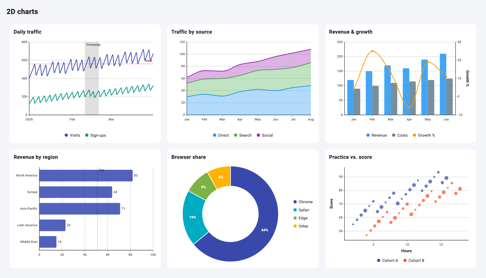
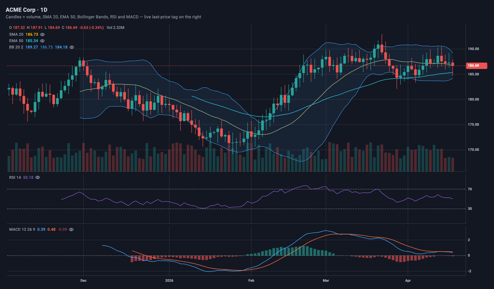
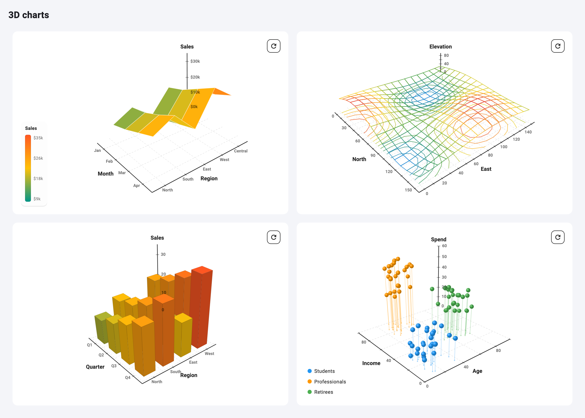
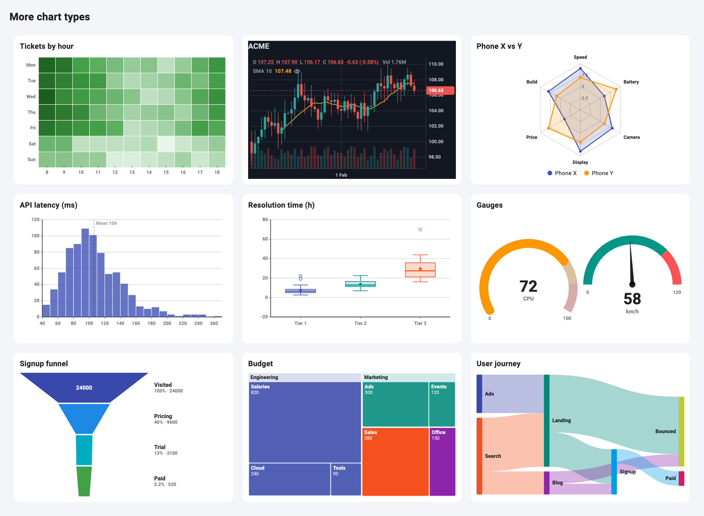

<h1 align="center">flutter_charts_kit</h1>

<p align="center">
  Interactive <b>3D surface</b> and <b>2D charts</b> — line, area, bar, combo, pie/donut, scatter,<br>
  heatmap, candlestick, radar, gauge, histogram, box plot, funnel, treemap, Sankey and sparklines —<br>
  zero dependencies, works on mobile, web and desktop.
</p>

<p align="center">
  <a href="https://pub.dev/packages/flutter_charts_kit"></a>
  <a href="https://pub.dev/packages/flutter_charts_kit/score"></a>
  <a href="https://github.com/Prajit7/flutter_charts_kit/actions/workflows/ci.yml"></a>
  <a href="LICENSE"></a>
</p>

<p align="center">
  <a href="https://flutter-charts-kit-gap4-flame.vercel.app/"><b>🚀 Live demo</b></a> ·
  <a href="https://pub.dev/packages/flutter_charts_kit"><b>📦 pub.dev</b></a> ·
  <a href="#usage"><b>📖 Usage</b></a>
</p>

<p align="center">
  
</p>
<p align="center">
  
</p>
<p align="center">
  
  
</p>

## Features

| | |
|---|---|
| 🧊 **3D surface, bars & scatter** | Turntable rotate, pinch/scroll zoom, auto-fit to any size, wireframe + contour modes, hover/tap tooltips, built-in legend |
| 📈 **Line & area** | Straight, smooth or step curves, stacked areas, time axis, crosshair, drag-to-zoom |
| 📊 **Bar** | Vertical or horizontal, grouped or stacked, value labels, category range zoom |
| 🔀 **Combo** | Bars + lines over shared categories, optional secondary y-axis, shared tooltip |
| 🍩 **Pie & donut** | Hover highlight, percentage labels, pinch zoom & pan |
| ⚬ **Scatter & bubble** | Per-point size, XY drag-to-zoom |
| 🟩 **Heatmap** | Row × column grid, gradient color scale, missing values, cell labels |
| 🕯️ **Trading chart** | Candles/OHLC, volume, live last-price tag, SMA/EMA, Bollinger, VWAP, RSI, MACD, gap-free time axis, dark by default |
| 🕸️ **Radar** | Multi-series spider chart with polygon or circular grid |
| ⏱️ **Gauge** | Arc or needle, colored ranges, animates between values |
| 📶 **Histogram & box plot** | Automatic nice binning; quartiles, whiskers and outliers |
| 🔻 **Funnel, treemap, Sankey** | Conversion steps, nested squarified tiles, flows between stages |
| ✏️ **Sparkline** | Tiny inline line/bar trend for lists and KPI cards |
| 📏 **Annotations** | Reference lines and shaded bands (targets, thresholds, date ranges) |
| 🎛️ **Control** | `ChartController` to reset zoom or export a PNG, custom tooltip builders, legend on any side |
| 🎨 **Theming** | `ChartThemeScope` with light/dark presets, titles, empty states, entrance animations |
| 🪶 **No dependencies** | Pure Flutter `CustomPainter` — nothing else pulled into your app |

The charts don't care what your data means — give them a grid or series,
labels, colors and a value formatter.

## Install

```yaml
dependencies:
  flutter_charts_kit: ^0.1.0
```

## Usage

```dart
import 'package:flutter_charts_kit/flutter_charts_kit.dart';

Surface3DChart(
  data: [
    [10, 40, 90],   // row 0 (e.g. "Jan")
    [15, 55, 120],  // row 1 (e.g. "Feb")
    [20, 70, 160],  // row 2 (e.g. "Mar")
  ],
  xLabels: ['North', 'South', 'East'],
  yLabels: ['Jan', 'Feb', 'Mar'],
  xAxisTitle: 'Region',
  yAxisTitle: 'Month',
  zAxisTitle: 'Revenue',
  valueFormatter: (v) => '\$${v.toStringAsFixed(0)}',
  gradient: [Colors.teal, Colors.amber, Colors.red],
)
```

### Stable colors across live/refreshed data

By default the gradient auto-scales to the min/max of whatever is in
`data` right now. If you're polling an API and want the same color to
always mean the same value (recommended for anything users compare over
time), pin the scale instead:

```dart
Surface3DChart(
  ...,
  fixedMin: 0,
  fixedMax: 100,
)
```

### Reference line

Draw a vertical dashed marker through a specific column (e.g. "today",
"current price"):

```dart
Surface3DChart(
  ...,
  referenceColIndex: 4,
  referenceLabel: 'Spot (24675)',
)
```

### Legend

Turn on the built-in color-scale legend:

```dart
Surface3DChart(
  ...,
  showLegend: true,
  legendAlignment: Alignment.bottomLeft, // any corner
)
```

Or place it yourself anywhere in your layout using the standalone widget
(e.g. outside the chart, in a sidebar):

```dart
Surface3DLegend(
  gradient: [Colors.teal, Colors.amber, Colors.red],
  min: 0,
  max: 100,
  valueFormatter: (v) => v.toStringAsFixed(0),
  title: 'OI',
  orientation: Axis.horizontal, // or Axis.vertical
)
```

### External reset control

```dart
final controller = Surface3DChartController();

Surface3DChart(controller: controller, ...);

ElevatedButton(onPressed: controller.resetView, child: Text('Reset view'));
```

### Custom tooltip

```dart
Surface3DChart(
  ...,
  tooltipBuilder: (context, hit) => Card(
    child: Text('${hit.xLabel} / ${hit.yLabel}: ${hit.value}'),
  ),
)
```

### 3D bars, 3D scatter, wireframe and contours

```dart
// Same data[row][col] shape as Surface3DChart
Bar3DChart(
  data: [[12, 18, 9], [15, 22, 14]],
  xLabels: ['North', 'South', 'East'],
  yLabels: ['Jan', 'Feb'],
  zAxisTitle: 'Sales',
)

// Three numeric axes, multiple series, drop lines to the floor
Scatter3DChart(
  xAxisTitle: 'Age', yAxisTitle: 'Income', zAxisTitle: 'Spend',
  showDropLines: true,
  series: [
    Scatter3DSeries(name: 'Students', color: Colors.blue, points: [
      Scatter3DPoint(x: 22, y: 20, z: 15, label: 'Ana'),
    ]),
  ],
)

// See-through surface with contour lines on the floor
Surface3DChart(
  ...,
  renderMode: SurfaceRenderMode.wireframe,
  showContours: true,
  contourLevels: 10,
)
```

All 3D charts use a turntable camera (drag sideways to spin around the
vertical axis, up/down to tilt), scale themselves to fill their box, and
keep axis labels on the edges facing you as you rotate. `Surface3DChart`
takes `fitToSize: false` to restore the old fixed scale.

## Example

`example/lib/simple_3d_demo.dart` — hardcoded data, no networking, ~40
lines. Run with `flutter run -t lib/simple_3d_demo.dart`.

`example/lib/charts_2d_demo.dart` — all four 2D chart types (line, bar,
pie/donut, scatter) with theming, titles, and drag-to-zoom.

## What's generic vs. what's app-specific

| Generic (package)              | App-specific (your code)                  |
|---------------------------------|--------------------------------------------|
| Rotation, zoom, projection       | What rows/columns represent                |
| Hit-testing & tooltip plumbing   | Networking, JSON parsing, polling           |
| Color gradient math              | Which colors, which fixed min/max           |
| Axis drawing                     | Axis titles, label text, formatting         |
| Reset button / controller        | Any extra app UI (tabs, refresh button)     |

## 2D chart types

Beyond the 3D surface, the package also includes four standard 2D chart
types, all sharing the same series-based API and a toggleable legend
(tap a legend entry to hide/show that series or slice — like Highcharts).

```dart
// Line chart, optionally filled
LineChart2D(
  series: [
    XySeries(name: 'Revenue', color: Colors.indigo, data: [
      ChartPoint(x: 1, y: 120, label: 'Jan'),
      ChartPoint(x: 2, y: 180, label: 'Feb'),
    ]),
  ],
  filled: true,
  xAxisTitle: 'Month',
  yAxisTitle: 'USD',
)

// Bar chart, grouped or stacked
BarChart2D(
  categories: ['Q1', 'Q2', 'Q3'],
  series: [
    CategorySeries(name: 'North', color: Colors.teal, values: [40, 55, 48]),
    CategorySeries(name: 'South', color: Colors.amber, values: [30, 35, 42]),
  ],
  stacked: true, // or false for grouped
)

// Pie or donut
PieChart2D(
  innerRadiusRatio: 0.6, // 0 for a solid pie
  slices: [
    PieSlice(label: 'Chrome', value: 64, color: Colors.blue),
    PieSlice(label: 'Safari', value: 19, color: Colors.orange),
  ],
)

// Scatter, or bubble chart if ChartPoint.size is set
ScatterChart2D(
  series: [
    XySeries(name: 'Cohort A', color: Colors.blue, data: [
      ChartPoint(x: 5.2, y: 88, label: 'Player 1'),
    ]),
  ],
  xAxisTitle: 'Hours practiced',
  yAxisTitle: 'Score',
)
```

See `example/lib/main.dart` for a runnable demo of every chart
(`flutter run` from inside `example/`).

### Curves, stacked areas and time axes

```dart
LineChart2D(
  xAxisType: ChartAxisType.time,     // ticks land on days / months / years
  curve: LineChartCurve.smooth,      // or .straight (default) or .step
  stacked: true, filled: true,       // stacked area chart
  series: [
    XySeries(name: 'Visits', color: Colors.indigo, data: [
      ChartPoint.at(DateTime(2026, 1, 1), y: 420),
      ChartPoint.at(DateTime(2026, 1, 2), y: 455),
    ]),
  ],
)
```

`smooth` uses monotone interpolation, so the curve never overshoots your
data with peaks or dips that aren't there. When stacked, tooltips and
callbacks still report each point's own value. `ScatterChart2D` supports
`xAxisType: ChartAxisType.time` too.

### Horizontal bars and value labels

```dart
BarChart2D(
  horizontal: true,          // categories down the left — good for long names
  showValueLabels: true,     // value at each bar's end (inside segments when stacked)
  categories: ['North America', 'Europe', 'Asia Pacific'],
  series: [CategorySeries(name: 'Revenue', color: Colors.indigo, values: [82, 64, 71])],
)
```

### Combo chart (bars + lines, two axes)

```dart
ComboChart2D(
  categories: ['Jan', 'Feb', 'Mar'],
  series: [
    ComboSeries(name: 'Revenue', color: Colors.blue, values: [120, 150, 170]),
    ComboSeries.line(name: 'Growth %', color: Colors.orange, values: [4, 25, 13], secondaryAxis: true),
  ],
  yAxisTitle: 'Revenue',
  secondaryYAxisTitle: 'Growth %',
)
```

Hovering a category shows every series' value there in one tooltip.

### Reference lines and bands

```dart
LineChart2D(
  ...,
  referenceLines: [
    ChartReferenceLine.y(100, label: 'Target', color: Colors.red),
    ChartReferenceLine.time(DateTime(2026, 3, 1), label: 'Launch'),
  ],
  referenceBands: [
    ChartReferenceBand.y(40, 60, label: 'Normal range'),
  ],
)
```

Supported by line, scatter, bar (value axis) and combo (primary axis)
charts. Lines outside the visible range are skipped rather than widening the axes.

### Controller: reset zoom, export PNG

```dart
final controller = ChartController();

LineChart2D(controller: controller, ...);

// from your own toolbar:
controller.resetZoom();
final Uint8List? png = await controller.toPngBytes(pixelRatio: 3);
```

`ChartController` is a `ChangeNotifier`; listen to it to enable a reset
button only while `controller.isZoomed`. Every 2D chart accepts one.

### Live data, big data, and updates

```dart
// Streaming: follow the last 30 seconds, update without animation
LineChart2D(
  xAxisType: ChartAxisType.time,
  liveWindow: 30000,
  updateAnimation: ChartUpdateAnimation.none,
  series: [XySeries(name: 'Sensor', color: Colors.teal, data: List.of(readings))],
)
```

- **Updates animate in place.** When a chart's data changes, lines and bars
  glide from their old values to the new ones (`ChartUpdateAnimation.morph`,
  the default) and zoom is kept. Use `.none` for streaming, or `.replay`
  for the old replay-the-entrance behavior.
- **Big series stay fast.** `LineChart2D` thins series longer than ~1.5
  points per pixel with LTTB downsampling (on by default; `downsample:
  false` to turn off), which keeps spikes and dips that naive sampling
  drops. 100k+ points render and hover smoothly.
- **Hover is cheap.** Line and scatter charts draw the hover highlight on
  its own layer, so moving the mouse never repaints the data.
- Charts compare data by value, so rebuilding with an equal list does
  nothing; pass a new list (e.g. `List.of(readings)`) when data changes.

### Legend position and custom tooltips

```dart
LineChart2D(
  legendPosition: ChartLegendPosition.right, // top, bottom (default), left, right, none
  tooltipBuilder: (context, series, point) => MyTooltip(series, point),
  ...,
)
```

Each chart takes a matching builder: `BarChart2D` gets
`(context, series, category, value)`, `PieChart2D` gets
`(context, slice, percent)`, and `ComboChart2D` gets
`(context, category, values)`.

### Zoom

Every chart supports zoom, adapted to what makes sense for its shape:

**`LineChart2D` and `ScatterChart2D`** — drag a rectangle over the plot to
zoom into that range. A reset button appears in the corner while zoomed.

```dart
LineChart2D(
  ...,
  zoomMode: ChartZoomMode.x,   // default: zoom x, y auto-rescales to fit
  // zoomMode: ChartZoomMode.xy, // zoom both axes to the dragged rectangle
  // zoomMode: ChartZoomMode.none, // disable drag-to-zoom
)

ScatterChart2D(
  ...,
  zoomMode: ChartZoomMode.xy,  // default for scatter — both axes carry meaning
)
```

**`BarChart2D`** — drag horizontally to zoom into a range of categories
(y auto-rescales); `zoomMode: ChartZoomMode.xy` also zooms the y-range to
the dragged rectangle's vertical extent.

```dart
BarChart2D(
  ...,
  zoomMode: ChartZoomMode.x, // default
)
```

**`PieChart2D`** — has no axes, so there's no "range" to drag-select.
Instead it zooms like a photo viewer: pinch (or scroll on desktop) to
zoom in, drag to pan while zoomed.

```dart
PieChart2D(
  ...,
  enableZoom: true, // default
  minZoomScale: 1.0,
  maxZoomScale: 4.0,
)
```

**`Surface3DChart`** — single-finger drag rotates, two-finger pinch (or
scroll wheel on desktop) zooms.

Every chart's zoom uses the same reset-button pattern: it only appears
while zoomed, and tapping it restores the exact original view.

## Trading chart

```dart
CandlestickChart2D(
  candles: candles,            // Candle(time:, open:, high:, low:, close:, volume:)
  showVolume: true,
  indicators: const [
    MovingAverageIndicator(period: 20),                                   // SMA
    MovingAverageIndicator(period: 50, type: MovingAverageType.exponential), // EMA
    BollingerBandsIndicator(),
    VwapIndicator(),
    RsiIndicator(),   // own pane
    MacdIndicator(),  // own pane
  ],
)
```

- **Gap-free:** candles are spaced evenly, so nights, weekends and holidays
  leave no gaps; the time axis labels day/month/year boundaries.
- **Live data:** feed trades into `LiveCandles`, which builds the candles
  and tracks the last traded price. The chart keeps zoom and hover across
  updates, and the price tag on the right axis flashes green/red per tick.

```dart
final live = LiveCandles(interval: const Duration(minutes: 1), maxCandles: 500, history: past);
socket.listen((t) => live.addTick(t.time, t.price, volume: t.qty));

ListenableBuilder(
  listenable: live,
  builder: (_, __) => CandlestickChart2D(
    candles: live.candles,
    lastPrice: live.lastPrice,
    visibleCandles: 90,      // follow the latest 90 until the user zooms
  ),
)
```

- **Dark by default:** uses `ChartTheme.trading` unless you pass `theme:` or
  wrap it in a `ChartThemeScope`.
- **Navigation, like trading apps:** drag to scroll back and forth through
  history (a quick swipe keeps gliding), pinch to zoom around your fingers.
  With a mouse, the wheel zooms and Shift+wheel or a sideways trackpad swipe
  scrolls. While the newest candle is in view the chart follows new candles
  at your zoom level; scroll back and it stays put until you tap reset.
  `enablePan` / `enableZoom` turn either off.
- **Crosshair:** hover (or long-press on touch screens) for price and time
  tags and the candle's O/H/L/C plus each indicator's value in the header.
- **Show/hide indicators:** each indicator's legend row has an eye button.
  A hidden overlay stops drawing and stops stretching the price scale; a
  hidden RSI/MACD keeps its pane so the layout doesn't jump. Listen with
  `onIndicatorVisibilityChanged`, or turn the buttons off with
  `showIndicatorToggles: false`.
- The indicator math is available directly: `RsiIndicator().compute(candles)`.

## More chart types

All of these share the same theming, titles, empty states, tooltips
(`tooltipBuilder` to customize) and `ChartController` image export.

```dart
// Heatmap: same data[row][col] grid as the 3D surface, null = missing
HeatmapChart2D(
  data: [[3, 7, null], [5, 1, 8]],
  xLabels: ['9am', '10am', '11am'],
  yLabels: ['Mon', 'Tue'],
  showValues: true,
)


// Radar / spider
RadarChart2D(
  axes: ['Speed', 'Power', 'Range', 'Comfort', 'Price'],
  series: [CategorySeries(name: 'Model A', color: Colors.blue, values: [8, 6, 7, 9, 4])],
  max: 10,
)

// Gauge: arc (progress) or needle; animates when value changes
GaugeChart(
  value: 72,
  label: 'CPU',
  ranges: [GaugeRange(from: 85, to: 100, color: Colors.red)],
  style: GaugeStyle.needle,
)

// Distribution of raw values
Histogram2D(values: latenciesMs, showMean: true)
BoxPlot2D(groups: [BoxPlotGroup(label: 'Team A', values: [12, 15, 14, 19, 41])])

// Conversion funnel, nested treemap, flow diagram
FunnelChart2D(stages: [FunnelStage(label: 'Visited', value: 12000), FunnelStage(label: 'Paid', value: 380)])
TreemapChart2D(nodes: [TreemapNode(label: 'Eng', children: [TreemapNode(label: 'Cloud', value: 240)])])
SankeyChart2D(links: [SankeyLink(source: 'Visits', target: 'Signed up', value: 3100)])

// Inline trend — give it a small bounded box
SizedBox(width: 100, height: 28, child: Sparkline(values: [3, 5, 4, 8, 6, 9]))
```

`HistogramBin.compute` and `BoxPlotStats.fromValues` are public if you
need the binning or quartiles yourself.

### Not included yet

This is a small, purpose-built library, not a Highcharts clone. Things it
does **not** do (yet): log scales and stacked percentage bars.

### Accessibility

Charts paint to a canvas, so each one also exposes a short screen-reader
summary — e.g. *"Line chart, Revenue. Revenue: 12 values from 80 to 210"*.
To describe a chart yourself, wrap it in
`Semantics(label: '...', excludeSemantics: true)`.

### Regenerating screenshots

`flutter test tool/screenshots_test.dart` re-renders `example/assets/*.png`
with real fonts. Golden tests (`test/goldens/`) cover every chart in light
and dark; refresh them with `flutter test --update-goldens test/golden_test.dart`. Contributions or follow-up
requests welcome.

### Theming

Wrap your app (or just a screen) in `ChartThemeScope` to apply consistent
colors/fonts to every chart beneath it — including `Surface3DChart` and its
legend. No per-chart configuration needed.

```dart
ChartThemeScope(
  theme: ChartTheme.dark, // or ChartTheme.light, or a custom ChartTheme(...)
  child: MaterialApp(...),
)
```

### Titles, empty states, callbacks

Every 2D chart accepts `title`/`subtitle` (rendered above the plot) and
shows a built-in "No data" placeholder automatically when its data is
empty — you don't need to check for empty data yourself.

Each chart also exposes hover/tap callbacks so your app can react to
interactions beyond the built-in tooltip:

```dart
LineChart2D(
  onPointHover: (series, point) => ..., // fires continuously, null on exit
  onPointTap: (series, point) => ...,   // fires once per tap/click
)
BarChart2D(onBarHover: ..., onBarTap: ...);
PieChart2D(onSliceHover: ..., onSliceTap: ...);
ScatterChart2D(onPointHover: ..., onPointTap: ...);
```

`LineChart2D` and `ScatterChart2D` also show a crosshair through the
hovered point by default (`showCrosshair: false` to disable).

### Animations

Every 2D chart animates in on first build and whenever its data changes
(line/combo: reveal left-to-right; bar: grows from the zero baseline;
pie/donut: grows radially from the center; scatter: pops in). Rebuilding
with equal data doesn't replay the animation or reset zoom.
Disable with `enableAnimation: false` or adjust `animationDuration`.
