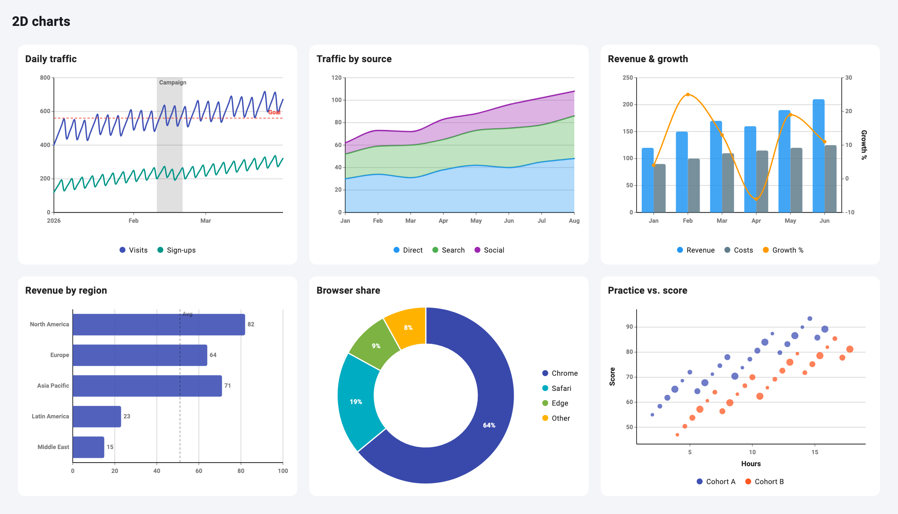
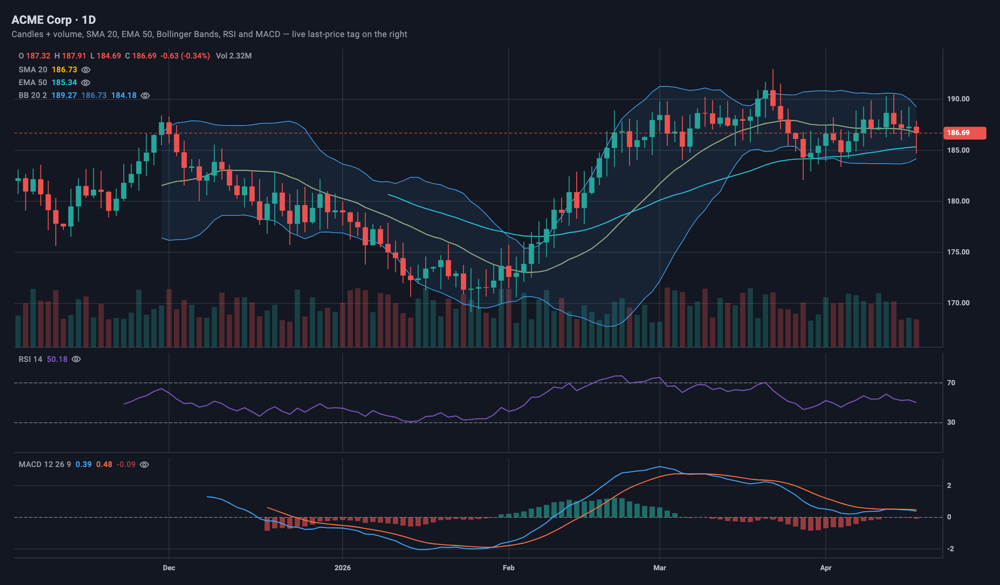
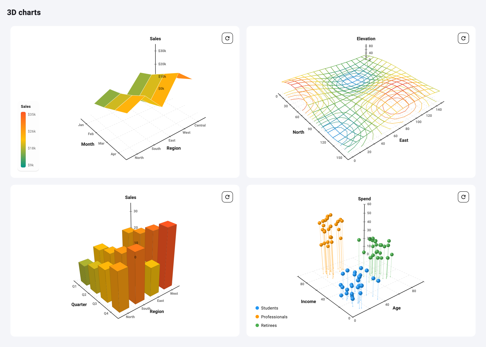
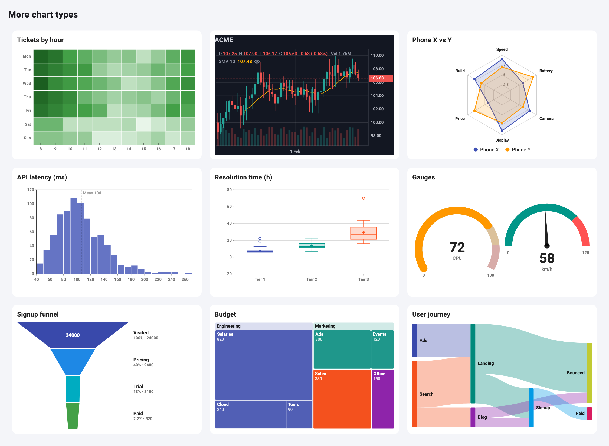
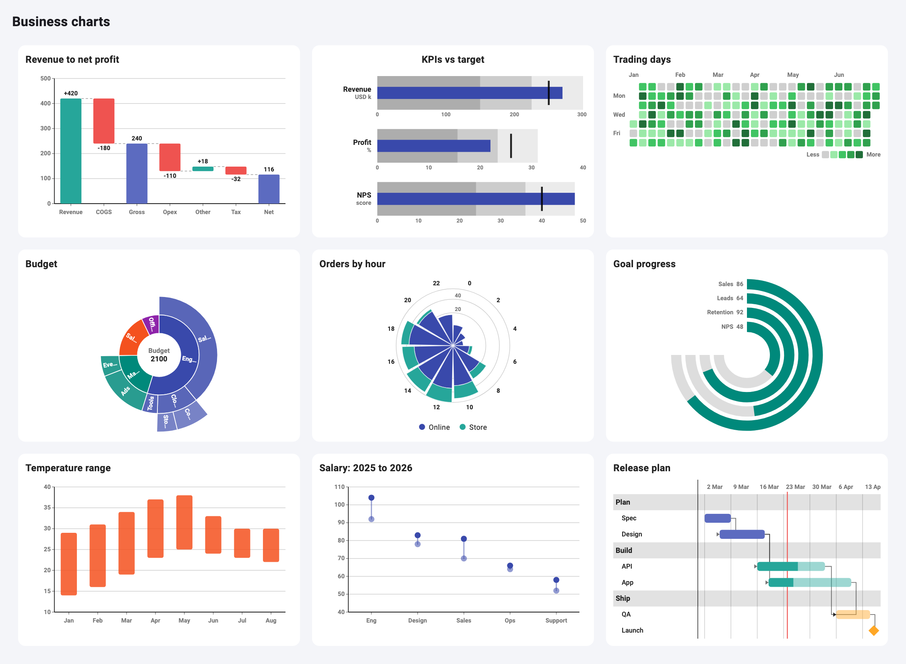
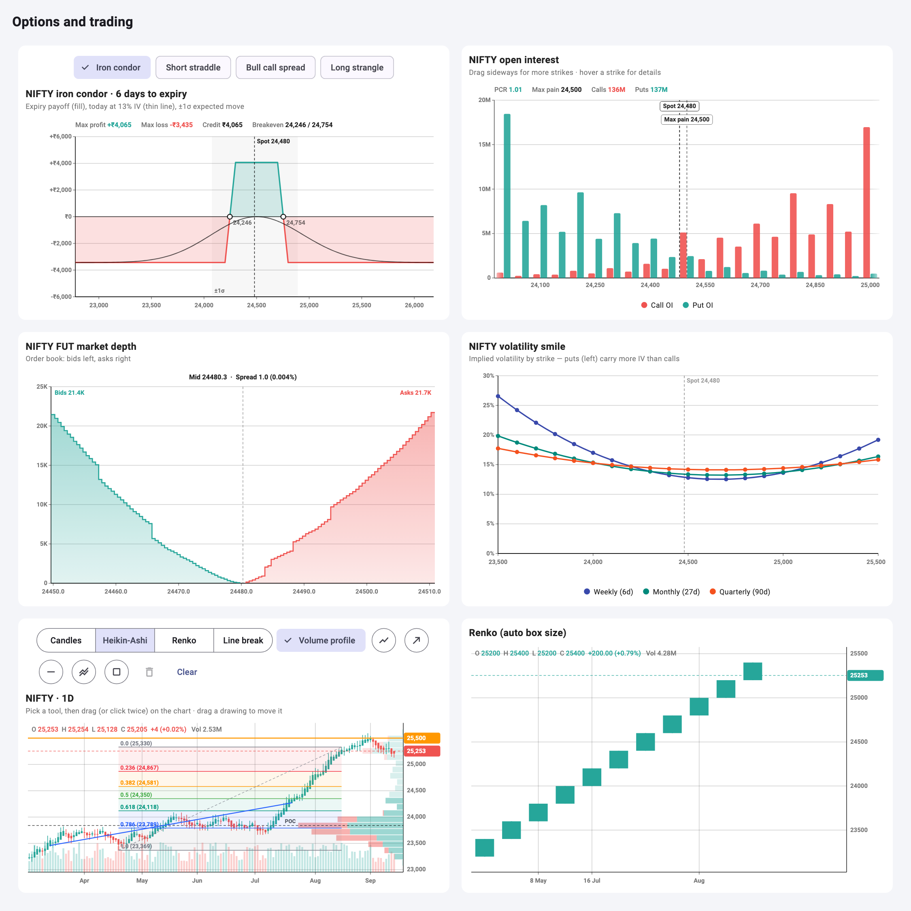
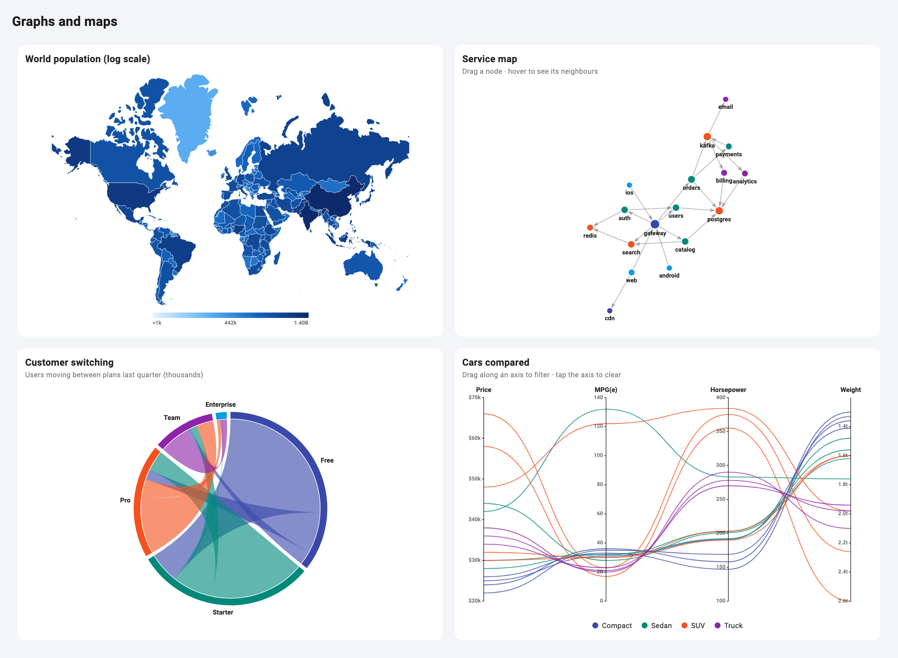

<h1 align="center">flutter_charts_kit</h1>

<p align="center">
  Interactive <b>3D surface</b> and <b>2D charts</b> — line, area, bar, combo, pie/donut, scatter,<br>
  heatmap, candlestick, radar, gauge, histogram, box plot, funnel, treemap, Sankey and sparklines —<br>
  zero dependencies, works on mobile, web and desktop.
</p>

<p align="center">
  <a href="https://pub.dev/packages/flutter_charts_kit"></a>
  <a href="https://pub.dev/packages/flutter_charts_kit/score"></a>
  <a href="https://github.com/Prajit7/flutter_charts_kit/actions/workflows/ci.yml"></a>
  <a href="LICENSE"></a>
</p>

<p align="center">
  <a href="https://flutter-charts-kit-gap4-flame.vercel.app/"><b>🚀 Live demo</b></a> ·
  <a href="https://pub.dev/packages/flutter_charts_kit"><b>📦 pub.dev</b></a> ·
  <a href="#usage"><b>📖 Usage</b></a>
</p>

<p align="center">
  
</p>
<p align="center">
  
</p>
<p align="center">
  
  
</p>
<p align="center">
  
</p>
<p align="center">
  
</p>
<p align="center">
  
</p>

## Features

| | |
|---|---|
| 🧊 **3D surface, bars & scatter** | Turntable rotate, pinch/scroll zoom, auto-fit to any size, wireframe + contour modes, hover/tap tooltips, built-in legend |
| 📈 **Line & area** | Straight, smooth or step curves, stacked areas, time axis, crosshair, drag-to-zoom |
| 📊 **Bar** | Vertical or horizontal, grouped or stacked, value labels, category range zoom |
| 🔀 **Combo** | Bars + lines over shared categories, optional secondary y-axis, shared tooltip |
| 🍩 **Pie & donut** | Hover highlight, percentage labels, pinch zoom & pan |
| ⚬ **Scatter & bubble** | Per-point size, XY drag-to-zoom |
| 🟩 **Heatmap** | Row × column grid, gradient color scale, missing values, cell labels |
| 🕯️ **Trading chart** | Candles/OHLC, Heikin-Ashi, Renko, line break, volume and volume profile, live last-price tag, SMA/EMA, Bollinger, VWAP, RSI, MACD, drawing tools (trendlines, levels, Fibonacci), dark by default |
| 🎯 **Options** | Strategy payoff (expiry + today curves, breakevens, max profit/loss), open interest by strike with max pain and PCR, market depth, volatility smile; Black-Scholes, Greeks and implied volatility in pure Dart |
| 🕸️ **Radar** | Multi-series spider chart with polygon or circular grid |
| ⏱️ **Gauge** | Arc or needle, colored ranges, animates between values |
| 📶 **Histogram & box plot** | Automatic nice binning; quartiles, whiskers and outliers |
| 🔻 **Funnel, treemap, Sankey** | Conversion steps, nested squarified tiles, flows between stages |
| ✏️ **Sparkline** | Tiny inline line/bar trend for lists and KPI cards |
| 💼 **Business charts** | Waterfall, bullet, calendar heatmap, sunburst (drill-down), rose & radial bars, range/dumbbell/error-bar/band, lollipop, Gantt |
| 🕸️ **Graphs & maps** | Force-directed network graph, chord diagram, parallel coordinates with brushing, choropleth maps from your own GeoJSON |
| 📏 **Annotations** | Reference lines and shaded bands (targets, thresholds, date ranges) |
| 🎛️ **Control** | `ChartController` to reset zoom or export PNG/SVG, linked crosshairs across charts, custom tooltips, legend on any side |
| 🔢 **Scales & labels** | Log axes, 100% stacked bars and areas, value labels, annotations pinned to data points |
| 🎨 **Theming** | `ChartThemeScope` with light/dark presets, titles, empty states, entrance animations |
| 🪶 **No dependencies** | Pure Flutter `CustomPainter` — nothing else pulled into your app |

The charts don't care what your data means — give them a grid or series,
labels, colors and a value formatter.

## Install

```yaml
dependencies:
  flutter_charts_kit: ^0.2.0
```

## Usage

```dart
import 'package:flutter_charts_kit/flutter_charts_kit.dart';

Surface3DChart(
  data: [
    [10, 40, 90],   // row 0 (e.g. "Jan")
    [15, 55, 120],  // row 1 (e.g. "Feb")
    [20, 70, 160],  // row 2 (e.g. "Mar")
  ],
  xLabels: ['North', 'South', 'East'],
  yLabels: ['Jan', 'Feb', 'Mar'],
  xAxisTitle: 'Region',
  yAxisTitle: 'Month',
  zAxisTitle: 'Revenue',
  valueFormatter: (v) => '\$${v.toStringAsFixed(0)}',
  gradient: [Colors.teal, Colors.amber, Colors.red],
)
```

### Stable colors across live/refreshed data

By default the gradient auto-scales to the min/max of whatever is in
`data` right now. If you're polling an API and want the same color to
always mean the same value (recommended for anything users compare over
time), pin the scale instead:

```dart
Surface3DChart(
  ...,
  fixedMin: 0,
  fixedMax: 100,
)
```

### Reference line

Draw a vertical dashed marker through a specific column (e.g. "today",
"current price"):

```dart
Surface3DChart(
  ...,
  referenceColIndex: 4,
  referenceLabel: 'Spot (24675)',
)
```

### Legend

Turn on the built-in color-scale legend:

```dart
Surface3DChart(
  ...,
  showLegend: true,
  legendAlignment: Alignment.bottomLeft, // any corner
)
```

Or place it yourself anywhere in your layout using the standalone widget
(e.g. outside the chart, in a sidebar):

```dart
Surface3DLegend(
  gradient: [Colors.teal, Colors.amber, Colors.red],
  min: 0,
  max: 100,
  valueFormatter: (v) => v.toStringAsFixed(0),
  title: 'OI',
  orientation: Axis.horizontal, // or Axis.vertical
)
```

### External reset control

```dart
final controller = Surface3DChartController();

Surface3DChart(controller: controller, ...);

ElevatedButton(onPressed: controller.resetView, child: Text('Reset view'));
```

### Custom tooltip

```dart
Surface3DChart(
  ...,
  tooltipBuilder: (context, hit) => Card(
    child: Text('${hit.xLabel} / ${hit.yLabel}: ${hit.value}'),
  ),
)
```

### 3D bars, 3D scatter, wireframe and contours

```dart
// Same data[row][col] shape as Surface3DChart
Bar3DChart(
  data: [[12, 18, 9], [15, 22, 14]],
  xLabels: ['North', 'South', 'East'],
  yLabels: ['Jan', 'Feb'],
  zAxisTitle: 'Sales',
)

// Three numeric axes, multiple series, drop lines to the floor
Scatter3DChart(
  xAxisTitle: 'Age', yAxisTitle: 'Income', zAxisTitle: 'Spend',
  showDropLines: true,
  series: [
    Scatter3DSeries(name: 'Students', color: Colors.blue, points: [
      Scatter3DPoint(x: 22, y: 20, z: 15, label: 'Ana'),
    ]),
  ],
)

// See-through surface with contour lines on the floor
Surface3DChart(
  ...,
  renderMode: SurfaceRenderMode.wireframe,
  showContours: true,
  contourLevels: 10,
)
```

All 3D charts use a turntable camera (drag sideways to spin around the
vertical axis, up/down to tilt), scale themselves to fill their box, and
keep axis labels on the edges facing you as you rotate. `Surface3DChart`
takes `fitToSize: false` to restore the old fixed scale.

## Example

**[Try the live demo](https://flutter-charts-kit-gap4-flame.vercel.app/)**, or run
it yourself with `flutter run` inside `example/`. It's a three-tab showcase
(dark by default, with a light/dark toggle):

- **2D charts:** line, area, bar, combo, pie, scatter, plus a streaming
  live sensor, a 100,000-point series, and `ChartController` export.
- **3D:** surface, wireframe with contours, 3D bars and 3D scatter.
- **More charts:** a live trading chart (ticks every 250ms, indicators,
  eye toggles), heatmap, radar, gauges, histogram, box plot, funnel,
  treemap, Sankey and sparkline KPI cards.

Two minimal single-file demos are there too:
`flutter run -t lib/simple_3d_demo.dart` (one 3D surface, ~40 lines) and
`flutter run -t lib/charts_2d_demo.dart` (the four core 2D charts).

## What's generic vs. what's app-specific

| Generic (package)              | App-specific (your code)                  |
|---------------------------------|--------------------------------------------|
| Rotation, zoom, projection       | What rows/columns represent                |
| Hit-testing & tooltip plumbing   | Networking, JSON parsing, polling           |
| Color gradient math              | Which colors, which fixed min/max           |
| Axis drawing                     | Axis titles, label text, formatting         |
| Reset button / controller        | Any extra app UI (tabs, refresh button)     |

## 2D chart types

The core 2D charts (line, bar, pie/donut and scatter) share the same
series-based API and a toggleable legend (tap a legend entry to hide/show
that series or slice, like Highcharts).

```dart
// Line chart, optionally filled
LineChart2D(
  series: [
    XySeries(name: 'Revenue', color: Colors.indigo, data: [
      ChartPoint(x: 1, y: 120, label: 'Jan'),
      ChartPoint(x: 2, y: 180, label: 'Feb'),
    ]),
  ],
  filled: true,
  xAxisTitle: 'Month',
  yAxisTitle: 'USD',
)

// Bar chart, grouped or stacked
BarChart2D(
  categories: ['Q1', 'Q2', 'Q3'],
  series: [
    CategorySeries(name: 'North', color: Colors.teal, values: [40, 55, 48]),
    CategorySeries(name: 'South', color: Colors.amber, values: [30, 35, 42]),
  ],
  stacked: true, // or false for grouped
)

// Pie or donut
PieChart2D(
  innerRadiusRatio: 0.6, // 0 for a solid pie
  slices: [
    PieSlice(label: 'Chrome', value: 64, color: Colors.blue),
    PieSlice(label: 'Safari', value: 19, color: Colors.orange),
  ],
)

// Scatter, or bubble chart if ChartPoint.size is set
ScatterChart2D(
  series: [
    XySeries(name: 'Cohort A', color: Colors.blue, data: [
      ChartPoint(x: 5.2, y: 88, label: 'Player 1'),
    ]),
  ],
  xAxisTitle: 'Hours practiced',
  yAxisTitle: 'Score',
)
```

See `example/lib/main.dart` for a runnable demo of every chart
(`flutter run` from inside `example/`).

### Curves, stacked areas and time axes

```dart
LineChart2D(
  xAxisType: ChartAxisType.time,     // ticks land on days / months / years
  curve: LineChartCurve.smooth,      // or .straight (default) or .step
  stacked: true, filled: true,       // stacked area chart
  series: [
    XySeries(name: 'Visits', color: Colors.indigo, data: [
      ChartPoint.at(DateTime(2026, 1, 1), y: 420),
      ChartPoint.at(DateTime(2026, 1, 2), y: 455),
    ]),
  ],
)
```

`smooth` uses monotone interpolation, so the curve never overshoots your
data with peaks or dips that aren't there. When stacked, tooltips and
callbacks still report each point's own value. `ScatterChart2D` supports
`xAxisType: ChartAxisType.time` too.

### Horizontal bars and value labels

```dart
BarChart2D(
  horizontal: true,          // categories down the left — good for long names
  showValueLabels: true,     // value at each bar's end (inside segments when stacked)
  categories: ['North America', 'Europe', 'Asia Pacific'],
  series: [CategorySeries(name: 'Revenue', color: Colors.indigo, values: [82, 64, 71])],
)
```

### Combo chart (bars + lines, two axes)

```dart
ComboChart2D(
  categories: ['Jan', 'Feb', 'Mar'],
  series: [
    ComboSeries(name: 'Revenue', color: Colors.blue, values: [120, 150, 170]),
    ComboSeries.line(name: 'Growth %', color: Colors.orange, values: [4, 25, 13], secondaryAxis: true),
  ],
  yAxisTitle: 'Revenue',
  secondaryYAxisTitle: 'Growth %',
)
```

Hovering a category shows every series' value there in one tooltip.

### Reference lines and bands

```dart
LineChart2D(
  ...,
  referenceLines: [
    ChartReferenceLine.y(100, label: 'Target', color: Colors.red),
    ChartReferenceLine.time(DateTime(2026, 3, 1), label: 'Launch'),
  ],
  referenceBands: [
    ChartReferenceBand.y(40, 60, label: 'Normal range'),
  ],
)
```

Supported by line, scatter, bar (value axis) and combo (primary axis)
charts. Lines outside the visible range are skipped rather than widening the axes.

### Controller: reset zoom, export PNG

```dart
final controller = ChartController();

LineChart2D(controller: controller, ...);

// from your own toolbar:
controller.resetZoom();
final Uint8List? png = await controller.toPngBytes(pixelRatio: 3);
```

`ChartController` is a `ChangeNotifier`; listen to it to enable a reset
button only while `controller.isZoomed`. Every 2D chart accepts one.

### Live data, big data, and updates

```dart
// Streaming: follow the last 30 seconds, update without animation
LineChart2D(
  xAxisType: ChartAxisType.time,
  liveWindow: 30000,
  updateAnimation: ChartUpdateAnimation.none,
  series: [XySeries(name: 'Sensor', color: Colors.teal, data: List.of(readings))],
)
```

- **Updates animate in place.** When a chart's data changes, lines and bars
  glide from their old values to the new ones (`ChartUpdateAnimation.morph`,
  the default) and zoom is kept. Use `.none` for streaming, or `.replay`
  for the old replay-the-entrance behavior.
- **Big series stay fast.** `LineChart2D` thins series longer than ~1.5
  points per pixel with LTTB downsampling (on by default; `downsample:
  false` to turn off), which keeps spikes and dips that naive sampling
  drops. 100k+ points render and hover smoothly.
- **Hover is cheap.** Line and scatter charts draw the hover highlight on
  its own layer, so moving the mouse never repaints the data.
- Charts compare data by value, so rebuilding with an equal list does
  nothing; pass a new list (e.g. `List.of(readings)`) when data changes.

### Log scales, 100% stacking, labels and annotations

```dart
LineChart2D(
  yAxisScale: ChartAxisScale.logarithmic,  // powers of ten get equal space
  showValueLabels: true,                   // value above each point
  annotations: [ChartAnnotation(x: 4, y: 1800, text: 'Launch')],
  ...,
)

BarChart2D(percentStacked: true, showValueLabels: true, ...)   // 0–100% shares
LineChart2D(percentStacked: true, filled: true, ...)           // 100% stacked area
ScatterChart2D(xAxisScale: ChartAxisScale.logarithmic, showPointLabels: true, ...)
```

Log axes show only positive values. With `percentStacked`, tooltips and
callbacks still report each value's real number alongside its share.
`ChartAnnotation` works on line, scatter, bar, combo and candlestick charts
(`x` is the category index for bar/combo, `ChartAnnotation.at(DateTime)`
for time axes and candles).

### Linked crosshairs

```dart
final sync = ChartCrosshairSync();

Column(children: [
  Expanded(child: CandlestickChart2D(crosshairSync: sync, candles: candles)),
  Expanded(child: LineChart2D(crosshairSync: sync, xAxisType: ChartAxisType.time, series: [...])),
])
```

Hover one chart and the others show a crosshair at the same x (the nearest
point is marked on line charts; candlesticks show that candle's values in
their header; bar and combo charts highlight the category). Linked charts
must share x units: data x, epoch milliseconds for time axes and
candlesticks, or category index for bar/combo.

### SVG export

```dart
final String? svg = controller.toSvg(background: Colors.white);
```

Vector output for reports and print: shapes, text, clipping and
backgrounds are exported; gradients and images are not, and curves become
fine polylines.

### Legend position and custom tooltips

```dart
LineChart2D(
  legendPosition: ChartLegendPosition.right, // top, bottom (default), left, right, none
  tooltipBuilder: (context, series, point) => MyTooltip(series, point),
  ...,
)
```

Each chart takes a matching builder: `BarChart2D` gets
`(context, series, category, value)`, `PieChart2D` gets
`(context, slice, percent)`, and `ComboChart2D` gets
`(context, category, values)`.

### Zoom

Every chart supports zoom, adapted to what makes sense for its shape:

**`LineChart2D` and `ScatterChart2D`** — drag a rectangle over the plot to
zoom into that range. A reset button appears in the corner while zoomed.

```dart
LineChart2D(
  ...,
  zoomMode: ChartZoomMode.x,   // default: zoom x, y auto-rescales to fit
  // zoomMode: ChartZoomMode.xy, // zoom both axes to the dragged rectangle
  // zoomMode: ChartZoomMode.none, // disable drag-to-zoom
)

ScatterChart2D(
  ...,
  zoomMode: ChartZoomMode.xy,  // default for scatter — both axes carry meaning
)
```

**`BarChart2D`** — drag horizontally to zoom into a range of categories
(y auto-rescales); `zoomMode: ChartZoomMode.xy` also zooms the y-range to
the dragged rectangle's vertical extent.

```dart
BarChart2D(
  ...,
  zoomMode: ChartZoomMode.x, // default
)
```

**`PieChart2D`** — has no axes, so there's no "range" to drag-select.
Instead it zooms like a photo viewer: pinch (or scroll on desktop) to
zoom in, drag to pan while zoomed.

```dart
PieChart2D(
  ...,
  enableZoom: true, // default
  minZoomScale: 1.0,
  maxZoomScale: 4.0,
)
```

**`Surface3DChart`** — single-finger drag rotates, two-finger pinch (or
scroll wheel on desktop) zooms.

Every chart's zoom uses the same reset-button pattern: it only appears
while zoomed, and tapping it restores the exact original view.

## Business charts

```dart
// Bridge from a starting value through changes; totals show the running sum
WaterfallChart2D(steps: [
  WaterfallStep(label: 'Revenue', value: 420),
  WaterfallStep(label: 'COGS', value: -180),
  WaterfallStep.total('Gross'),
  WaterfallStep(label: 'Opex', value: -110),
  WaterfallStep.total('Net'),
])

// A KPI against its target over qualitative bands — stack several in a Column
BulletChart(label: 'Revenue', value: 270, target: 250,
    ranges: [BulletRange(150), BulletRange(225), BulletRange(300)])

// One cell per day, GitHub-style
CalendarHeatmap(values: {DateTime(2026, 3, 2): 4, DateTime(2026, 3, 3): 9})

// Hierarchy as rings (same TreemapNode as the treemap); tap to drill down
SunburstChart2D(nodes: [TreemapNode(label: 'Eng', children: [...])])

// Rose (wedge per category) or radial bars (ring per category)
PolarBarChart2D(categories: [...], series: [...], style: PolarBarStyle.rose)

// Low–high ranges: floating bars, dumbbells, error bars or a shaded band
RangeChart2D(categories: [...], style: RangeChartStyle.dumbbell, series: [
  RangeSeries(name: 'Salary', color: Colors.indigo, values: [RangeValue(92, 104)]),
])

// Lollipop style for any bar chart
BarChart2D(barStyle: BarStyle.lollipop, ...)

// Tasks over time with progress, milestones and dependency arrows
GanttChart2D(tasks: [
  GanttTask(id: 'design', label: 'Design', start: d1, end: d2, progress: 1),
  GanttTask(id: 'build', label: 'Build', start: d2, end: d3, dependsOn: ['design']),
  GanttTask.milestone(label: 'Launch', at: d3, dependsOn: ['build']),
])
```

For dumbbells, `RangeValue(from, to)` draws `from` faded and `to` solid,
so the direction of change reads at a glance. The Gantt chart scrolls by
drag and zooms by pinch or mouse wheel.

## Graphs and maps

```dart
// Force-directed network: drag nodes, pan, pinch/scroll to zoom
NetworkGraph2D(
  directed: true,
  nodes: [GraphNode(id: 'web', group: 'clients'), GraphNode(id: 'api', group: 'core')],
  edges: [GraphEdge('web', 'api')],
)

// Flows between groups; matrix[from][to]
ChordChart2D(labels: ['Free', 'Pro', 'Team'], matrix: [
  [0, 42, 4],
  [6, 0, 17],
  [1, 5, 0],
])

// Many measures per item; drag along an axis to filter, tap it to clear
ParallelCoordinatesChart2D(
  axes: [ParallelAxis('Price'), ParallelAxis('MPG'), ParallelAxis('Weight', inverted: true)],
  records: [ParallelRecord([24, 36, 1.3], label: 'Civic', group: 'Compact')],
  onSelectionChanged: (matching) => ...,
)

// Regions shaded by value, from GeoJSON you supply
final features = GeoFeature.parse(await rootBundle.loadString('assets/india_states.geojson'));
ChoroplethMap2D(
  features: features,                 // id = properties['name'] (see idProperty)
  values: {'Karnataka': 67.6, 'Kerala': 35.7},
  logScale: false,
  projection: MapProjection.mercator,
)
```

The package bundles **no map data**, so it stays small and works for any
country, state or district level: pass any GeoJSON `FeatureCollection` of
Polygon/MultiPolygon features. The example app uses
[Natural Earth](https://www.naturalearthdata.com/)'s public-domain 1:110m
countries (`example/assets/world_110m.geojson`). The network graph runs a
small physics simulation; pass `enableAnimation: false` to compute the
layout up front (deterministic — handy for tests and screenshots).

## Trading chart

```dart
CandlestickChart2D(
  candles: candles,            // Candle(time:, open:, high:, low:, close:, volume:)
  showVolume: true,
  indicators: const [
    MovingAverageIndicator(period: 20),                                   // SMA
    MovingAverageIndicator(period: 50, type: MovingAverageType.exponential), // EMA
    BollingerBandsIndicator(),
    VwapIndicator(),
    RsiIndicator(),   // own pane
    MacdIndicator(),  // own pane
  ],
)
```

- **Gap-free:** candles are spaced evenly, so nights, weekends and holidays
  leave no gaps; the time axis labels day/month/year boundaries.
- **Live data:** feed trades into `LiveCandles`, which builds the candles
  and tracks the last traded price. The chart keeps zoom and hover across
  updates, and the price tag on the right axis flashes green/red per tick.

```dart
final live = LiveCandles(interval: const Duration(minutes: 1), maxCandles: 500, history: past);
socket.listen((t) => live.addTick(t.time, t.price, volume: t.qty));

ListenableBuilder(
  listenable: live,
  builder: (_, __) => CandlestickChart2D(
    candles: live.candles,
    lastPrice: live.lastPrice,
    visibleCandles: 90,      // follow the latest 90 until the user zooms
  ),
)
```

- **Dark by default:** uses `ChartTheme.trading` unless you pass `theme:` or
  wrap it in a `ChartThemeScope`.
- **Navigation, like trading apps:** drag to scroll back and forth through
  history (a quick swipe keeps gliding), pinch to zoom around your fingers.
  With a mouse, the wheel zooms and Shift+wheel or a sideways trackpad swipe
  scrolls. While the newest candle is in view the chart follows new candles
  at your zoom level; scroll back and it stays put until you tap reset.
  `enablePan` / `enableZoom` turn either off.
- **Crosshair:** hover (or long-press on touch screens) for price and time
  tags and the candle's O/H/L/C plus each indicator's value in the header.
- **Show/hide indicators:** each indicator's legend row has an eye button.
  A hidden overlay stops drawing and stops stretching the price scale; a
  hidden RSI/MACD keeps its pane so the layout doesn't jump. Listen with
  `onIndicatorVisibilityChanged`, or turn the buttons off with
  `showIndicatorToggles: false`.
- The indicator math is available directly: `RsiIndicator().compute(candles)`.

### Candle types, volume profile and drawing tools

```dart
final drawings = ChartDrawingController();

CandlestickChart2D(
  candles: candles,
  candleType: CandleType.heikinAshi,       // or renko (renkoBoxSize:), lineBreak (lineBreakCount:)
  volumeProfile: const VolumeProfile(),     // volume at price, POC and 70% value area
  drawingController: drawings,
)

// From your toolbar:
drawings.startDrawing(DrawingTool.trendLine); // also ray, horizontalLine, fibonacci, rectangle
drawings.removeSelected();
final saved = jsonEncode(drawings.toJson());  // persist per symbol…
drawings.loadJson(jsonDecode(saved));         // …and restore
```

- **Candle types:** indicators, volume and the O/H/L/C header follow the
  transformed bars; the last-price tag keeps the real price. Renko's box
  size defaults to a round number near the 14-period ATR. The transforms
  are public: `CandleTransforms.heikinAshi(candles)`.
- **Volume profile** covers the candles in view, so it updates as you
  scroll and zoom. `VolumeProfileResult.compute` gives you the numbers.
- **Drawing:** with a tool armed, drag from the first point to the second,
  or click once for each (a horizontal level takes one click). Without a
  tool, tap a drawing to select it, drag a handle to reshape it or the line
  to move it; Delete/Backspace removes it, Escape cancels. Points are stored
  as time + price, so drawings stay put through zoom, scroll and live
  updates, and can extend into the future.

## Options

```dart
// Payoff of a strategy: expiry (filled) and today (Black-Scholes) curves
OptionPayoffChart2D(
  spot: 24480,
  daysToExpiry: 6,
  volatility: 0.13,                  // for legs without their own iv:
  legs: [
    OptionLeg.put(strike: 24200, premium: 18, quantity: 1, lotSize: 75),
    OptionLeg.put(strike: 24300, premium: 34, quantity: -1, lotSize: 75),
    OptionLeg.call(strike: 24700, premium: 30, quantity: -1, lotSize: 75),
    OptionLeg.call(strike: 24800, premium: 15, quantity: 1, lotSize: 75),
  ],
)

// Calls vs puts per strike, with spot, max pain and PCR; scrolls sideways
OpenInterestChart2D(spot: 24480, strikes: [
  OptionStrikeData(strike: 24500, callOI: 8.2e6, putOI: 6.1e6, callOIChange: 9e5, putOIChange: -2e5),
  ...
], view: OpenInterestView.change)   // or .total

// Order book as cumulative bids/asks; pass new lists as it updates
MarketDepthChart2D(bids: [DepthLevel(24479.5, 300), ...], asks: [DepthLevel(24480.5, 450), ...])

// Implied volatility by strike, one curve per expiry
VolatilitySmileChart2D(spot: 24480, smiles: [
  VolatilitySmile(label: 'Weekly', color: Colors.indigo, points: {24000: 0.168, 24500: 0.131, 25000: 0.142}),
])
```

The maths is public and dependency-free:

```dart
OptionMath.blackScholes(type: OptionType.call, spot: 24480, strike: 24500, years: 6 / 365, volatility: 0.13);
OptionMath.greeks(...);                // delta, gamma, theta (per day), vega, rho (per 1%)
OptionMath.impliedVolatility(price: 182, type: OptionType.call, spot: 24480, strike: 24500, years: 6 / 365);
OptionMath.breakevens(legs); OptionMath.maxProfit(legs); OptionMath.maxLoss(legs); // null = unlimited
OptionMath.maxPain([(strike, callOI, putOI), ...]);
```

Payoff details: `quantity` is signed (negative = sell), `lotSize` scales
the P&L, `OptionLeg.underlying(price:)` adds a stock/future leg, and legs
with a later `daysToExpiry` (calendars) keep their time value at the near
expiry. Black-Scholes assumes European options with no dividends.

## More chart types

All of these share the same theming, titles, empty states, tooltips
(`tooltipBuilder` to customize) and `ChartController` image export.

```dart
// Heatmap: same data[row][col] grid as the 3D surface, null = missing
HeatmapChart2D(
  data: [[3, 7, null], [5, 1, 8]],
  xLabels: ['9am', '10am', '11am'],
  yLabels: ['Mon', 'Tue'],
  showValues: true,
)


// Radar / spider
RadarChart2D(
  axes: ['Speed', 'Power', 'Range', 'Comfort', 'Price'],
  series: [CategorySeries(name: 'Model A', color: Colors.blue, values: [8, 6, 7, 9, 4])],
  max: 10,
)

// Gauge: arc (progress) or needle; animates when value changes
GaugeChart(
  value: 72,
  label: 'CPU',
  ranges: [GaugeRange(from: 85, to: 100, color: Colors.red)],
  style: GaugeStyle.needle,
)

// Distribution of raw values
Histogram2D(values: latenciesMs, showMean: true)
BoxPlot2D(groups: [BoxPlotGroup(label: 'Team A', values: [12, 15, 14, 19, 41])])

// Conversion funnel, nested treemap, flow diagram
FunnelChart2D(stages: [FunnelStage(label: 'Visited', value: 12000), FunnelStage(label: 'Paid', value: 380)])
TreemapChart2D(nodes: [TreemapNode(label: 'Eng', children: [TreemapNode(label: 'Cloud', value: 240)])])
SankeyChart2D(links: [SankeyLink(source: 'Visits', target: 'Signed up', value: 3100)])

// Inline trend — give it a small bounded box
SizedBox(width: 100, height: 28, child: Sparkline(values: [3, 5, 4, 8, 6, 9]))
```

`HistogramBin.compute` and `BoxPlotStats.fromValues` are public if you
need the binning or quartiles yourself.

### Not included yet

This is a small, purpose-built library, not a Highcharts clone. Things it
does **not** do (yet): log scales on bar charts, SVG export of the 3D charts,
or map tiles (choropleth maps draw your GeoJSON shapes only).

### Accessibility

Charts paint to a canvas, so each one also exposes a short screen-reader
summary — e.g. *"Line chart, Revenue. Revenue: 12 values from 80 to 210"*.
To describe a chart yourself, wrap it in
`Semantics(label: '...', excludeSemantics: true)`.

### Regenerating screenshots

`flutter test tool/screenshots_test.dart` re-renders `example/assets/*.png`
with real fonts. Golden tests (`test/goldens/`) cover every chart in light
and dark; refresh them with `flutter test --update-goldens test/golden_test.dart`. Contributions or follow-up
requests welcome.

### Theming

Wrap your app (or just a screen) in `ChartThemeScope` to apply consistent
colors/fonts to every chart beneath it — including `Surface3DChart` and its
legend. No per-chart configuration needed.

```dart
ChartThemeScope(
  theme: ChartTheme.dark, // or ChartTheme.light, or a custom ChartTheme(...)
  child: MaterialApp(...),
)
```

### Titles, empty states, callbacks

Every 2D chart accepts `title`/`subtitle` (rendered above the plot) and
shows a built-in "No data" placeholder automatically when its data is
empty — you don't need to check for empty data yourself.

Each chart also exposes hover/tap callbacks so your app can react to
interactions beyond the built-in tooltip:

```dart
LineChart2D(
  onPointHover: (series, point) => ..., // fires continuously, null on exit
  onPointTap: (series, point) => ...,   // fires once per tap/click
)
BarChart2D(onBarHover: ..., onBarTap: ...);
PieChart2D(onSliceHover: ..., onSliceTap: ...);
ScatterChart2D(onPointHover: ..., onPointTap: ...);
```

`LineChart2D` and `ScatterChart2D` also show a crosshair through the
hovered point by default (`showCrosshair: false` to disable).

### Animations

Every 2D chart animates in on first build and whenever its data changes
(line/combo: reveal left-to-right; bar: grows from the zero baseline;
pie/donut: grows radially from the center; scatter: pops in). Rebuilding
with equal data doesn't replay the animation or reset zoom.
Disable with `enableAnimation: false` or adjust `animationDuration`.
